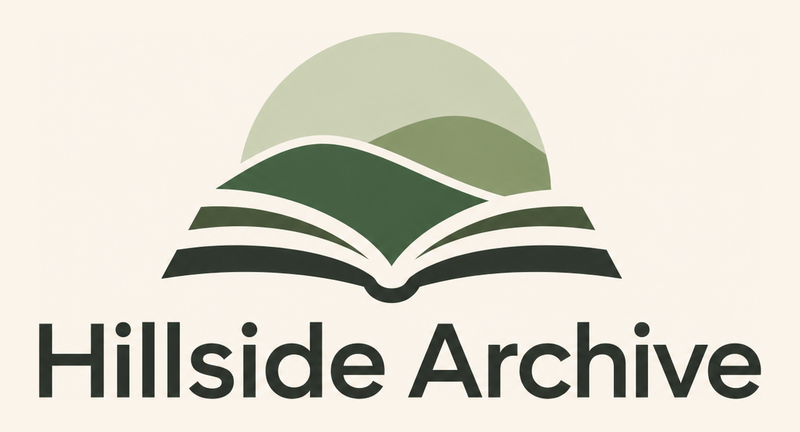

  

  <a href="https://hillsidearchive.org"><b>hillsidearchive.org</b></a>
  ·
  <a href="../../issues/new/choose">Report an issue</a>
  ·
  <a href="../../discussions">Discussions</a>

# Hillside Archive

Hillside Archive brings the public teaching of
[Hillside Hermitage](https://hillsidehermitage.org), a Buddhist monastery, into
one place where it can be read, searched and asked about.

The teaching is spread over recorded talks on two YouTube channels, written
answers on Reddit, and sutta translations. Hillside Archive collects it, makes
it readable as text, and links every passage back to where it came from.

Hillside Archive is not an official Hillside Hermitage project. It is an
independent project, made with Hillside Hermitage's permission.

## What is in the archive

- **Talks** from the [Hillside Hermitage](https://www.youtube.com/@HillsideHermitage)
  and [Samanadipa Hermitage](https://www.youtube.com/@SamanadipaHermitage)
  YouTube channels, transcribed to text with speakers identified. Transcripts are machine-made and
  then reviewed, so errors can remain; each transcript links to its video.
- **Writing on Reddit**: posts and comment answers by Bhante Anigha, shown
  with the thread they answer.
- **Sutta translations** from [suttas.hillsidehermitage.org](https://suttas.hillsidehermitage.org),
  with the translation and the commentary attributed separately.

New talks and Reddit answers are added regularly.

## What you can do on the site

- **Browse** the archive by date and filter it by source.
- **Search** across talks, Reddit writing and suttas.
- **Ask the chat** a question about the teaching. It answers only from the talks and
  the Reddit writing, cites the passages it uses so you can
  check them, and says so when the sources do not cover a question instead of
  guessing. Sutta translations are not used for chat answers, because the chat
  answers what Hillside Hermitage says, not what a translation says on its own.

The chat can still be wrong. Always check an answer against its cited sources.

## About this repository

This repository is the public place for feedback on Hillside Archive. It holds
no code; the application source is not public.

| You want to… | Use |
|---|---|
| Report something that does not work | [Bug report](../../issues/new?template=bug_report.yml) |
| Suggest a new feature or an improvement | [Feature request](../../issues/new?template=feature_request.yml) |
| Report a transcript error | The **Report an error** button on the talk's page |
| Report a wrong date, title or missing source | [Content error](../../issues/new?template=content_error.yml) |
| Ask a question or discuss an idea | [Discussions](../../discussions) |
| Report a wrong or unsupported chat answer | The **Report** button under the answer in the chat |

Please search the existing issues before opening a new one.

Transcript errors and wrong chat answers are reported on the site itself, not
here. On a talk's page, click **Report an error**, then the line that is wrong;
you can type the corrected text and add a comment. Under a chat answer, the
**Report** button sends the answer together with the sources it was given.

## Contributing

Contributions are welcome, whether code, transcript review, or ideas. The
application source code is in a private repository, so to contribute code
please contact [pc386](https://github.com/pc386) and ask for access.

You do not need access to help: bug reports, content corrections and feature
requests in this repository are contributions too.

## Thanks

Thanks to [Tejveer Rehsi](https://github.com/tejveeer) for his help with
development and for his advice.
